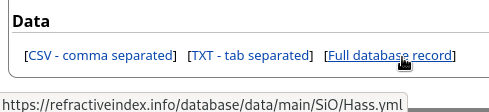

# Python interface to RefractiveIndex database


The original database<br>
https://github.com/polyanskiy/refractiveindex.info-database

## Installation

```
pip install refractiveindex
```

The package includes the refractiveindex.info database, so the library needs no network access. The download is about 15 MB. See [Database version](#database-version).

## Usage

```python
import numpy as np
from refractiveindex import RefractiveIndexMaterial

# Tabulated nk material
SiO = RefractiveIndexMaterial(shelf='main', book='SiO', page='Hass')

SiO.get_refractive_index(600)
# 1.96553846

SiO.get_extinction_coefficient(600)
# 0.001

SiO.get_epsilon(600)
# (3.8633404437869827+0.003931076923076923j)

# Formula-based material
bk7 = RefractiveIndexMaterial(shelf='specs', book='SCHOTT-optical', page='N-BK7')
bk7.get_refractive_index(589.3)
# 1.5168...

# Array input
wavelengths = np.array([400, 500, 600, 700])
SiO.get_refractive_index(wavelengths)
# array([2.15092857, 1.999, 1.96553846, 1.942])
```

### Units

All methods accept an optional `unit=` parameter. Default is `nm`. The following calls are all equivalent:

```python
bk7.get_refractive_index(589.3)                 # nm (default)
bk7.get_refractive_index(5893, unit='A')         # Angstrom
bk7.get_refractive_index(5.893e-7, unit='m')     # meters
bk7.get_refractive_index(0.5893, unit='um')      # µm
bk7.get_refractive_index(16978, unit='cm-1')     # wavenumbers
bk7.get_refractive_index(508.8, unit='THz')      # terahertz
bk7.get_refractive_index(2.108, unit='eV')       # electron volts
```

The same parameter works for `get_extinction_coefficient`, `get_epsilon`, and `get_wl_range`.

| Unit | String | Conversion from µm |
|---|---|---|
| meters | `'m'` | $\lambda{[\text{m}]} = \lambda{[\mu\text{m}]} \cdot 10^{-6}$ |
| nanometers | `'nm'` | $\lambda{[\text{nm}]} = \lambda{[\mu\text{m}]} \cdot 10^{3}$ |
| Angstroms | `'A'` | $\lambda{[\text{Å}]} = \lambda{[\mu\text{m}]} \cdot 10^{4}$ |
| wavenumbers | `'cm-1'` | $\tilde{\nu}{[\text{cm}^{-1}]} = 10^4 / \lambda{[\mu\text{m}]}$ |
| terahertz | `'THz'` | $\nu{[\text{THz}]} = \frac{c[\text{m}/\text{s}] \cdot 10^{-6}}{\lambda{[\mu\text{m}]}}$ |
| electron volts | `'eV'` |  $E [\text{eV}] = \frac{h[\text{J}\cdot \text{s}]\cdot c[\text{m}/\text{s}] \cdot 10^{6}}{e[\text{C}] \cdot \lambda [\mu \text{m}]}$  |

Here $c$ is the speed of light, $h$ is the Plank constant, $e$ is the elementary charge. 

### Valid wavelength range

Every material exposes the wavelength range over which its data are defined:

```python
# Returns (min, max) in the requested unit
bk7.get_wl_range()            # e.g. (300.0, 2500.0)   nm
bk7.get_wl_range(unit='um')   # e.g. (0.3, 2.5)        µm
bk7.get_wl_range(unit='cm-1') # e.g. (4000.0, 33333.3) cm⁻¹
```

Result is always returned as `(min, max)`. 

### Out-of-range behavior

No exception is raised for out-of-range wavelengths, but the returned value is not reliable:

| Data type | Out-of-range result |
|---|---|
| Tabulated (`n`, `k`, `nk`) | `nan` |
| Formula (1–9) | Silent extrapolation — may be unphysical, or `nan` with a `RuntimeWarning` if the formula evaluates a square root of a negative number |

Check `get_wl_range()` before querying if you are not certain the wavelength is within the measured range:

```python
lo, hi = mat.get_wl_range()
if lo <= wavelength <= hi:
    n = mat.get_refractive_index(wavelength)
else:
    raise ValueError(f"wavelength {wavelength} nm is outside the valid range [{lo}, {hi}] nm")
```

Notes:
- Here the time dependence is assumed to be $\mathrm{e}^{-\mathrm{i} \omega t}$, so $\mathrm{Im}(\varepsilon) > 0$ is responsible for the losses. For the opposite convention, use `exp_type`:
  ```python
  SiO.get_epsilon(600, exp_type="exp(+iwt)")  # (n - ik)^2
  # (3.8633404437869827-0.003931076923076923j)
  ```
  The default is `exp_type="exp(-iwt)"`. You can also write `"exp(iwt)"`, `j` instead of `i`, and `ω` instead of `w`, for example `"exp(-jωt)"`. 
- If there is a space in the name, write underscore instead, i.e. not `page='Rodriguez-de Marcos'` but `page='Rodriguez-de_Marcos'`.
- All 9 [dispersion formula types](https://github.com/polyanskiy/refractiveindex.info-database/blob/master/database/doc/Dispersion%20formulas.pdf) used by the refractiveindex.info database are supported: Sellmeier (1), Sellmeier-2 (2), Polynomial (3), RefractiveIndex.INFO (4), Cauchy (5), Gases (6), Herzberger (7), Retro (8), and Exotic (9).
- The data comes from the database included in the package. See [Database version](#database-version).

## How to get material page names

You can find the proper "page" name by hovering your cursor on the link in the Data section



Or you can look up folders in this repository<br>
https://github.com/polyanskiy/refractiveindex.info-database

## Similar projects

- [PyTMM](https://github.com/kitchenknif/PyTMM) by [Pavel Dmitriev](https://github.com/kitchenknif) — the original database parsing code this project was based on
- [RefractiveIndex.jl](https://github.com/stillyslalom/RefractiveIndex.jl) — Julia interface to refractiveindex.info database

## Database version

The package includes a release of the [refractiveindex.info database](https://github.com/polyanskiy/refractiveindex.info-database), so a version of the package always gives the same data. To see which release it includes:

```python
import refractiveindex
refractiveindex.DATABASE_VERSION  # 'v2026-05-24'
refractiveindex.DATABASE_COMMIT   # the upstream commit of this release
```

A new upstream release comes with a new version of the package:
```shell
pip install --upgrade refractiveindex
```

### Use another copy of the database

To use data that is newer than the included release, clone the upstream repository and give its `database/` folder as `db_path`:

```shell
git clone https://github.com/polyanskiy/refractiveindex.info-database
```

```python
SiO2 = RefractiveIndexMaterial(shelf='main', book='SiO2', page='Malitson',
                               db_path='refractiveindex.info-database/database')
```

### Old database folder

Versions before 1.2.0 downloaded the database to `~/.refractiveindex.info-database`. Version 1.2.0 and later do not use this folder, so you can delete it.

## How to cite

If you use the data in research, cite the refractiveindex.info database, as its author asks:

> M. N. Polyanskiy, "Refractiveindex.info database of optical constants," *Scientific Data* **11**, 94 (2024). https://doi.org/10.1038/s41597-023-02898-2

To make your results reproducible, also give the database version, for example "refractiveindex.info database v2026-05-24, used through the refractiveindex Python package 1.2.0".

The database is in the public domain ([CC0 1.0](https://creativecommons.org/publicdomain/zero/1.0/)). A copy of its licence is in `refractiveindex/database/LICENSE`.

## TODO

1. Include EODG data
2. Search
3. Material from URL
